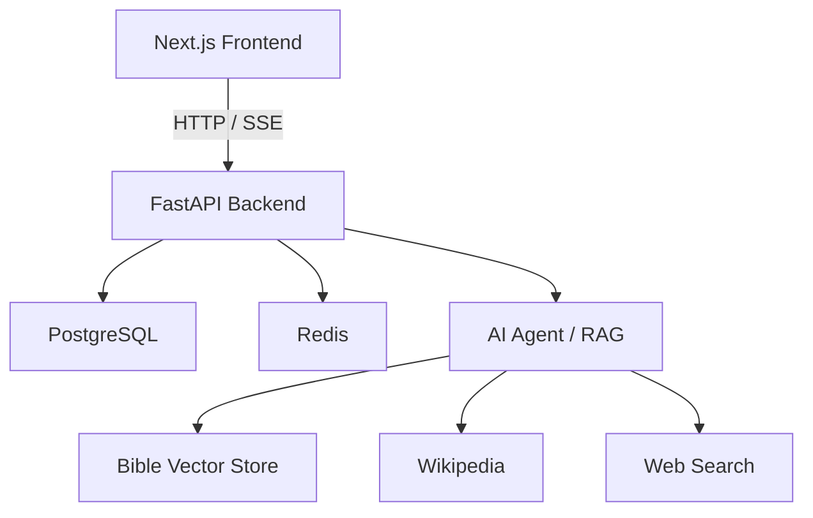

# VerseChat: Your Christian Assistant to Bible Knowledge

## Architectural Overview

**Frontend**: Next.js, React, Tailwind CSS, TypeScript\
 **Backend**: FastAPI, Python, LangChain \
 **LLM Provider**: GroqAPI \
 **Database**: PostgreSQL, SQLAlchemy\
 **Caching**: Redis

## Architecture Diagram



## Running the Application Locally

**Prerequisites**: Ensure you have Docker and Docker Compose installed on your machine.

1. Clone the repository:

   ```bash
   git clone https://github.com/amulyaprasanth/versechatv2.git
   ```

2. Change into the project directory:

   ```bash
   cd versechatv2
   ```

3. Copy `.env.example` to `.env`, set your application secrets, create the ignored PostgreSQL password file, and start the stack:

   ```bash
   cp .env.example .env
   mkdir -p .secrets
   openssl rand -base64 36 > .secrets/postgres_password
   chmod 600 .secrets/postgres_password
   docker compose up --build
   ```

   Compose mounts the password file as a secret for PostgreSQL and the API. PostgreSQL keeps its data in the `postgres_data` volume. The API waits for the database health check before starting.
   The existing SQLite file is left untouched; its data is not copied into PostgreSQL automatically.

4. Access the application at `http://localhost:3000`.

## Acknowledgements

Raw bible data was taken from this [Repo](https://github.com/thiagobodruk/bible)
by [thiagobodruk](https://github.com/thiagobodruk).

We are grateful to the author for making the project available under
the MIT License.
